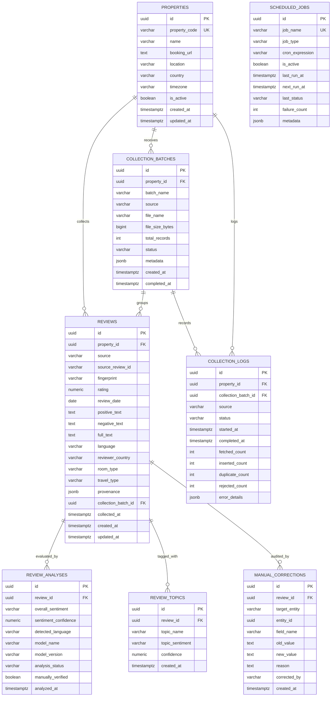

# Database Documentation & Entity-Relationship Model

**Platform:** AZZURRO INSIGHTS
**Database Engine:** Supabase PostgreSQL
**Timezone Policy:** All timestamps stored in `UTC`, reporting viewed in `Australia/Sydney`.

---

## 1. Entity-Relationship Diagram (ERD)

---

## 2. Table Specifications & Indexes

### 1. `properties`
Stores the four managed hotel properties.
- **Primary Key:** `id` (UUID)
- **Unique:** `property_code`
- **Seeded Records:**
  1. `OLYMPIC-PADDINGTON` — Olympic Hotel Paddington
  2. `POTTS-POINT` — Potts Point
  3. `CENTRAL-SYDNEY` — Central Sydney
  4. `DARLING-HARBOUR` — Darling Harbour

### 2. `collection_batches`
Tracks files and jobs during review ingestion.
- **Foreign Key:** `property_id -> properties(id) ON DELETE CASCADE`
- **Check Constraints:** `source IN ('csv_import', 'json_import', 'playwright_authorized', 'manual_entry')`

### 3. `reviews`
Single source of truth for all guest reviews.
- **Foreign Key:** `property_id -> properties(id) ON DELETE CASCADE`, `collection_batch_id -> collection_batches(id) ON DELETE SET NULL`
- **Deduplication:**
  - Unique index on `(property_id, source, source_review_id)` where source ID exists.
  - Unique index on `(property_id, fingerprint)` to catch identical review text hashes.
- **Indexes:**
  - `idx_reviews_property_id` on `property_id`
  - `idx_reviews_review_date` on `review_date`
  - `idx_reviews_rating` on `rating`
  - `idx_reviews_collected_at` on `collected_at`

### 4. `review_analyses`
Historical and current sentiment classification per review.
- **Foreign Key:** `review_id -> reviews(id) ON DELETE CASCADE`
- **Check Constraints:** `overall_sentiment IN ('positive', 'neutral', 'negative', 'mixed')`, confidence `0 <= val <= 1`.
- **Indexes:**
  - `idx_review_analyses_review_id`
  - `idx_review_analyses_sentiment`

### 5. `review_topics`
Extracted operational topics (e.g. cleanliness, staff, location, wifi).
- **Foreign Key:** `review_id -> reviews(id) ON DELETE CASCADE`
- **Constraint:** Unique index on `(review_id, topic_name)` preventing duplicate topics per review.

### 6. `collection_logs`
Audit trails for data collection runs.
- **Check Constraints:** `status IN ('started', 'success', 'warning', 'failed')`

### 7. `manual_corrections`
Full audit trail of human edits, overrides, or sentiment adjustments.
- **Foreign Key:** `review_id -> reviews(id) ON DELETE CASCADE`

### 8. `scheduled_jobs`
Metadata and execution statuses for background cron jobs.

---

## 3. Row Level Security (RLS) Strategy

- **Privileged backend operations:** Use Supabase `service_role` key via Node.js backend. All mutations bypass RLS through the server.
- **Anonymous client access:** Strict read-only access on active properties, completed review analyses, and topics. Zero insert/update/delete capabilities.
- **Future Manager / Admin Roles:**
  - Hotel managers have read-only access.
  - Authorized admins possess permissions to submit manual corrections and inspect collection logs.

