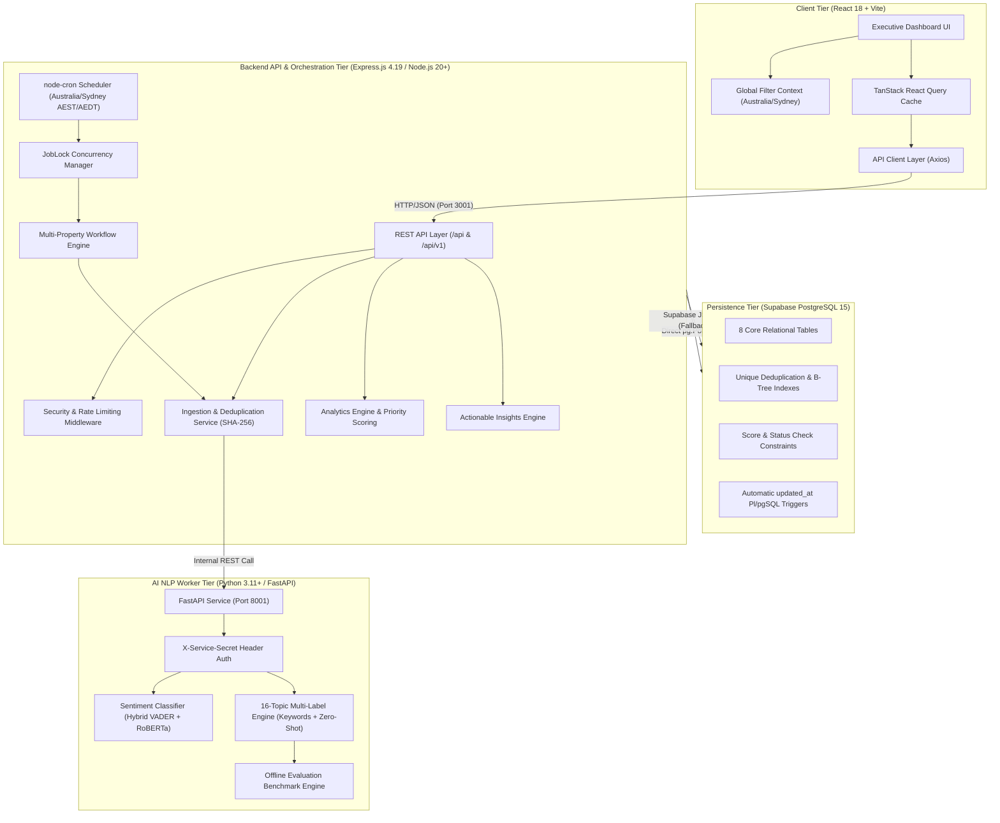
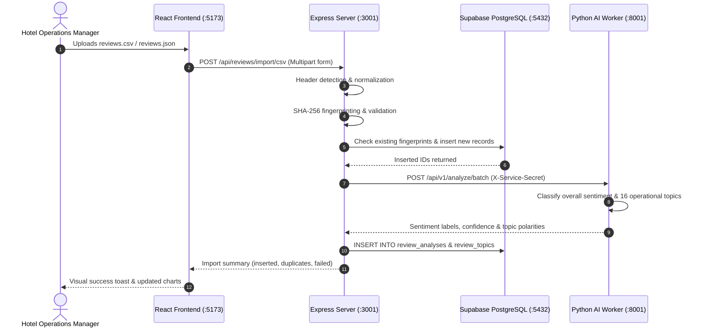

# AZZURRO INSIGHTS — System Architecture & Design Specification

## 1. High-Level System Architecture

AZZURRO INSIGHTS is a multi-tier, microservice-inspired hotel review intelligence platform architected for Azzurro Hotels Sydney. The platform processes high-volume guest feedback across four boutique hotels in Sydney, transforming unstructured natural language into actionable operational intelligence and executive KPIs.

---

## 2. Component Breakdown

### 2.1 Frontend Client (`client/`)
* **Framework:** React 18 with Vite 7.3 build tooling.
* **Styling & UI:** Tailwind CSS with custom Azzurro luxury palette (`azzurro-900` deep slate, `azzurro-600` primary navy, subtle border rings, rounded cards).
* **Data Visualization:** Recharts for daily rating trendlines, sentiment distribution bar charts, and operational complaint heatmaps.
* **State Management:** TanStack React Query for query deduplication, background refetching, and cache invalidation, paired with a custom `FilterContext` providing Australia/Sydney timezone synchronization and portfolio/hotel filtering.
* **Iconography:** Lucide React for consistent, crisp iconography.

### 2.2 Backend API & Orchestration (`server/`)
* **Framework:** Express.js 4.19 running on Node.js 20+ (CommonJS modular runtime with ES-module testing interop).
* **Connection Pooling:** Direct PostgreSQL connection pooling via `pg.Pool` (max 8 connections to stay within Supabase limits) with automated fallback to the Supabase JS REST client when required.
* **Automation Scheduler:** `node-cron` orchestrator pinned to the `Australia/Sydney` timezone. Manages recurring daily ingestion (02:00 AM Sydney time), weekly snapshot briefings (Monday 03:00 AM), and recurrent AI queue processing.
* **Concurrency Locking:** Atomic `JobLock` manager preventing race conditions during parallel scheduled tasks or manual triggers, featuring auto-expiration timeouts (60 seconds default).
* **Resilience:** Multi-property fault isolation ensuring that a connection timeout or validation failure for one hotel (e.g. Olympic Hotel Paddington) never halts execution for the remaining properties (Potts Point, Central Sydney, Darling Harbour).

### 2.3 AI Natural Language Processing Worker (`ai-worker/`)
* **Framework:** Python 3.11/3.13 with FastAPI and Uvicorn.
* **Architecture:** Decoupled microservice communicating over private HTTP with mandatory `X-Service-Secret` header authentication.
* **Inference Strategy:** 100% locally executable models with zero mandatory dependency on external paid APIs (OpenAI, Claude, Gemini):
  - **Sentiment:** Hybrid pipeline combining VADER lexical scoring with CardiffNLP Twitter-RoBERTa sentiment transformer fallback.
  - **Operational Topics:** High-precision domain-specific lexical keyword dictionary with phrase matching mapped across 16 hotel operational categories, with fallback to zero-shot transformer classification.
  - **Negation & Opposing Clause Handling:** Splits compound sentences on contrastive conjunctions (*"but"*, *"however"*, *"although"*, *"except"*) to assign independent positive and negative polarities to distinct operational topics.

### 2.4 Database Tier (`database/`)
* **Engine:** Supabase PostgreSQL 15.
* **Schema Design:** Fully normalized 8-table relational architecture with UUID primary keys, foreign key constraints, `ON DELETE CASCADE` rules, numeric score bounds checks (`0 <= rating <= 10`), and SHA-256 fingerprint uniqueness constraints for idempotent deduplication.

---

## 3. Communication Protocols & Security Boundaries

### Security Measures:
1. **Zero Credential Exposure:** Service-role keys and PostgreSQL connection strings exist solely in `server/.env`. The client receives only the public anonymous key (`VITE_SUPABASE_ANON_KEY`).
2. **Internal Service Token:** Node and Python services share an out-of-band secret verified on every inference call (`AI_SERVICE_SECRET`).
3. **Helmet Security Headers:** Content-Security-Policy, anti-clickjacking, DNS prefetch control, and frameguard enabled globally.
4. **CORS Whitelisting:** Express CORS middleware strictly enforces allowed origins (`http://localhost:5173` in development, dedicated production domain in production).
5. **Rate Limiting:** Sliding-window rate limiters on standard APIs (100 requests per 15 min) and dedicated strict limiters on file upload endpoints (20 imports per 15 min).
6. **Playwright Air-Gap:** The browser scraping adapter is disabled by default in code (`playwrightAuthorized: false`) and returns HTTP 403 Forbidden unless written legal authorization is verified.

---

## 4. Scalability & Operational Characteristics

| Attribute | Specification | Implementation Strategy |
| :--- | :--- | :--- |
| **Max Batch Size** | 100 MB / 5,000 rows | Streams file memory via Multer buffer into transactional batch insert. |
| **Inference Latency** | < 15ms per review | Pure Python in-memory keyword matching + cached PyTorch weights. |
| **Query Performance** | < 25ms overview aggregation | B-Tree indexes on `review_date`, `rating`, `property_id`, and `fingerprint`. |
| **Idempotence** | 100% duplicate immunity | Dual-key uniqueness: `(source, source_review_id)` and `(property_id, fingerprint)`. |
| **Timezone Alignment** | Australia/Sydney (UTC+10 / UTC+11) | Stored as UTC in PostgreSQL; date-truncated to Sydney calendar weeks. |
