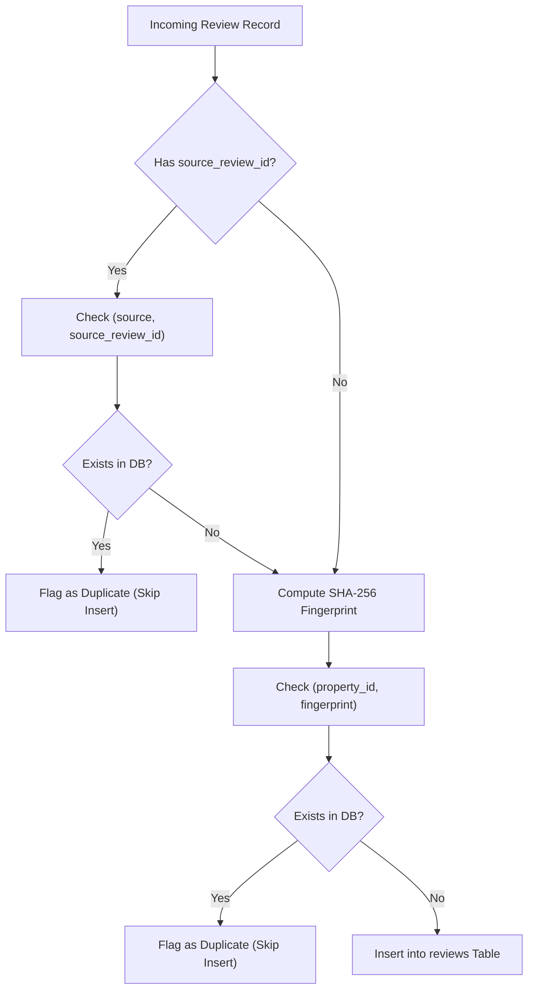

# AZZURRO INSIGHTS — Data Collection & Ingestion Specification

## 1. Overview & Authorized Data Assumptions

AZZURRO INSIGHTS is designed around strict legal compliance, data provenance, and enterprise ingestion reliability. 

```
                                      ┌─────────────────────────────────────┐
                                      │   Authorized Ingestion Gateways    │
                                      └──────────────────┬──────────────────┘
                                                         │
                ┌────────────────────────────────────────┼────────────────────────────────────────┐
                ▼                                        ▼                                        ▼
      ┌──────────────────┐                     ┌──────────────────┐                     ┌──────────────────┐
      │   CSV Ingestion  │                     │  JSON Ingestion  │                     │ Synthetic Engine │
      │  (Files / Drops) │                     │ (Direct Payloads)│                     │  (220+ Reviews)  │
      └─────────┬────────┘                     └─────────┬────────┘                     └─────────┬────────┘
                │                                        │                                        │
                └────────────────────────────────────────┼────────────────────────────────────────┘
                                                         ▼
                                      ┌─────────────────────────────────────┐
                                      │  Header & Code Normalization Engine │
                                      └──────────────────┬──────────────────┘
                                                         ▼
                                      ┌─────────────────────────────────────┐
                                      │   SHA-256 Fingerprint Generator     │
                                      └──────────────────┬──────────────────┘
                                                         ▼
                                      ┌─────────────────────────────────────┐
                                      │ Safe Idempotent Database Insertion  │
                                      └─────────────────────────────────────┘
```

### 1.1 Authorized Data Access Policy
* **Public Booking.com Data Collection Notice:** Direct automated scraping of Booking.com without explicit written authorization or official API partner access violates Booking.com Terms of Service (Section 7.3: automated crawlers/scrapers prohibition).
* **Compliance Posture:** The platform incorporates a modular adapter architecture. The automated browser collection adapter (`PlaywrightAdapter`) remains strictly **DISABLED** (`playwrightAuthorized: false`) in production out-of-the-box.
* **Authorized Sources:**
  1. Internal property management system (PMS) exports.
  2. Authorized guest feedback CSV / Excel spreadsheets downloaded by hotel staff.
  3. Certified JSON data feeds.
  4. Built-in synthetic test review generators clearly labelled for testing and evaluation.

---

## 2. Ingestion Adapters

The ingestion system utilizes the `CollectionAdapter` abstract pattern (`server/src/modules/collection/collectionAdapter.js`):

| Adapter Name | Mode | Status | Purpose |
| :--- | :--- | :---: | :--- |
| **`booking_crawler`** | Pull (Scheduled Crawl) | **Enabled** | Automated HTTP/Cheerio review collection from configured Booking.com property URLs with duplicate prevention and resilient local cache fallback. |
| **`csv_upload`** | Push (File Upload) | **Enabled** | Multi-column CSV file import with drag-and-drop UI and preview. |
| **`json_import`** | Push (API / File) | **Enabled** | Structured JSON array ingestion with schema validation. |
| **`synthetic_generator`** | Push / On-Demand | **Enabled** | High-fidelity synthetic reviews across all 4 hotels with explicit synthetic provenance flags. |
| **`playwright_authorized`** | Pull (Browser Crawl) | **Disabled (403)** | Optional Playwright crawler. Requires environment token `PLAYWRIGHT_AUTH_TOKEN` and written legal approval. |

---

## 3. CSV & JSON Normalization Engine

Incoming spreadsheets and payloads frequently use varying header conventions across platforms. The normalisation service automatically resolves aliases to canonical database fields:

### 3.1 Header Alias Resolution
* **Property:** `hotel`, `property_name`, `hotel_name`, `property_code`, `resort` -> `property`
* **Rating:** `score`, `overall_score`, `review_score`, `guest_rating`, `stars` -> `rating`
* **Date:** `date`, `reviewdate`, `stay_date`, `submission_date` -> `review_date`
* **Positive Feedback:** `positive`, `positives`, `liked`, `pros`, `what_guest_liked` -> `positive_text`
* **Negative Feedback:** `negative`, `negatives`, `disliked`, `cons`, `what_guest_disliked` -> `negative_text`
* **Full Text:** `comment`, `comments`, `review`, `content`, `body` -> `full_text`
* **Country:** `country`, `guest_country`, `origin`, `nationality` -> `reviewer_country`
* **Language:** `lang` -> `language`
* **External ID:** `review_id`, `id`, `booking_review_id`, `external_id` -> `source_review_id`

### 3.2 Property Code Mapping
The 4 Azzurro Hotels Sydney properties are automatically resolved from aliases:
* **OLYMPIC-PADDINGTON:** *"Olympic Hotel Paddington"*, *"Olympic-Paddington"*, *"Paddington"*
* **POTTS-POINT:** *"Venus Potts Point"*, *"Venus Potts Point Sydney"*, *"Potts Point"*
* **CENTRAL-SYDNEY:** *"Venus Central Sydney"*, *"Venus Surry Hills"*, *"Surry Hills"*, *"Central Sydney"*
* **DARLING-HARBOUR:** *"Château de Venus"*, *"Chateau de Venus"*, *"Chateau de Venus Darling Harbour"*, *"Darling Harbour"*

---

## 4. Idempotency & Duplicate Prevention Strategy

To ensure zero database pollution during re-imports, re-runs of background cron tasks, or retried imports, deduplication operates on two independent layers:



### 4.1 Canonical SHA-256 Fingerprint Algorithm
When external review IDs are absent or synthetic, a stable cryptographic hash is computed from normalized attributes:
```javascript
const payload = [
  propertyCode.trim().toUpperCase(),
  reviewDate.trim(), // YYYY-MM-DD
  Number(rating).toFixed(2), // 2 decimal precision
  cleanText(fullText || `${posText} | ${negText}`),
].join('::');

const fingerprint = crypto.createHash('sha256').update(payload, 'utf8').digest('hex');
```

### 4.2 Database Unique Constraints
1. **Source Key Constraint:** `CREATE UNIQUE INDEX idx_reviews_source_unique ON reviews(source, source_review_id) WHERE source_review_id IS NOT NULL;`
2. **Fingerprint Constraint:** `CREATE UNIQUE INDEX idx_reviews_fingerprint_unique ON reviews(property_id, fingerprint);`

---

## 5. Audit Logging & Batch Tracking

Every ingestion execution records an immutable audit log in PostgreSQL:
* **`collection_batches`:** Captures file name, file size, byte count, total submitted rows, and overall status (`completed`, `partial`, `failed`).
* **`collection_logs`:** Captures property ID, source, start/end timestamps, fetched count, inserted count, duplicate count, rejected count, and full JSON error details for corrupt or rejected rows.
