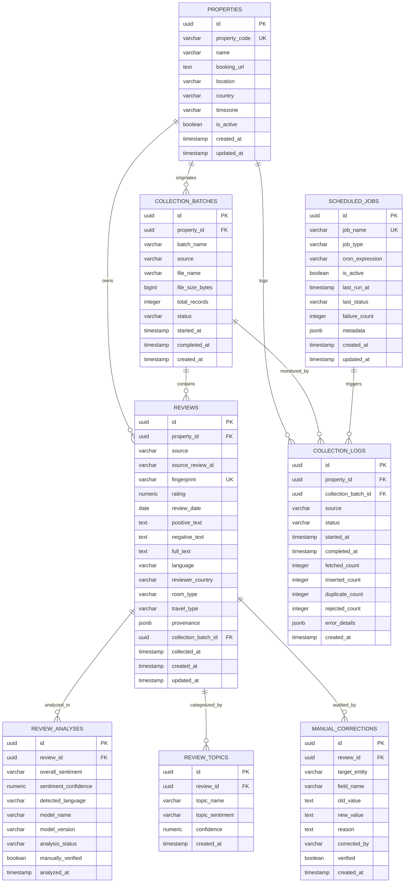

# AZZURRO INSIGHTS — PostgreSQL Database Schema Specification

## 1. Entity-Relationship Diagram

AZZURRO INSIGHTS uses an 8-table relational schema hosted on Supabase PostgreSQL 15, managed exclusively via sequential SQL migrations located in `database/migrations/`.

---

## 2. Table Specifications & Constraints

### 2.1 `properties`
Stores the hotel portfolio master data.
* **Primary Key:** `id` UUID (`gen_random_uuid()`)
* **Unique Keys:** `property_code` (e.g. `OLYMPIC-PADDINGTON`, `POTTS-POINT`, `CENTRAL-SYDNEY`, `DARLING-HARBOUR`)
* **Constraints:** `timezone` default `'Australia/Sydney'`, `is_active` default `true`.

### 2.2 `reviews`
Stores normalized guest reviews across all channels.
* **Primary Key:** `id` UUID
* **Foreign Keys:**
  - `property_id` -> `properties(id)` ON DELETE RESTRICT
  - `collection_batch_id` -> `collection_batches(id)` ON DELETE SET NULL
* **Check Constraints:**
  - `chk_reviews_rating`: `rating >= 0 AND rating <= 10`
* **Unique Indexes:**
  - `idx_reviews_source_unique`: `(source, source_review_id) WHERE source_review_id IS NOT NULL`
  - `idx_reviews_fingerprint_unique`: `(property_id, fingerprint)`

### 2.3 `review_analyses`
Stores immutable AI model sentiment outputs and classification metadata.
* **Primary Key:** `id` UUID
* **Foreign Key:** `review_id` -> `reviews(id)` ON DELETE CASCADE
* **Check Constraints:**
  - `chk_analysis_sentiment`: `overall_sentiment IN ('positive', 'negative', 'neutral', 'mixed')`
  - `chk_analysis_status`: `analysis_status IN ('pending', 'processing', 'completed', 'failed')`
  - `chk_analysis_confidence`: `sentiment_confidence >= 0 AND sentiment_confidence <= 1`

### 2.4 `review_topics`
Multi-label operational topic classifications and polarities.
* **Primary Key:** `id` UUID
* **Foreign Key:** `review_id` -> `reviews(id)` ON DELETE CASCADE
* **Check Constraints:**
  - `chk_topic_sentiment`: `topic_sentiment IN ('positive', 'negative', 'neutral')`
  - `chk_topic_confidence`: `confidence >= 0 AND confidence <= 1`
* **Unique Constraint:** `UNIQUE (review_id, topic_name)` (A review has at most one record per topic name)

### 2.5 `collection_batches`
Tracks batches ingested via CSV, JSON, or automated workflows.
* **Check Constraints:** `status IN ('pending', 'processing', 'completed', 'partial', 'failed')`

### 2.6 `collection_logs`
Fine-grained operational audit log of every collection and ingestion event.
* **Status Check:** `status IN ('running', 'success', 'completed', 'partial', 'warning', 'failed')`
* **Columns:** `fetched_count`, `inserted_count`, `duplicate_count`, `rejected_count`, `error_details` (JSONB)

### 2.7 `manual_corrections`
Non-destructive audit trail of human corrections. Original AI outputs in `review_analyses` remain untouched.
* **Columns:** `target_entity`, `field_name`, `old_value`, `new_value`, `reason`, `corrected_by`, `verified`

### 2.8 `scheduled_jobs`
Registry for node-cron automated collection tasks and recurring background workers.
* **Columns:** `job_name` (UNIQUE), `job_type`, `cron_expression`, `is_active`, `last_run_at`, `last_status`, `failure_count`, `metadata`

---

## 3. Migration Sequence

Migrations are executed deterministically and never modified after deployment:
* `database/migrations/001_initial_schema.sql` — Complete 8-table schema, check constraints, foreign keys, and indexes.
* `database/migrations/002_seed_properties.sql` — Master seed for all 4 Azzurro Hotels Sydney properties.
* `database/migrations/003_seed_demo_reviews.sql` — Synthetic sample dataset (220 reviews) with verified sentiment and topic records.
* `database/migrations/004_seed_scheduled_jobs.sql` — Registry for the 7 standard background cron jobs.
